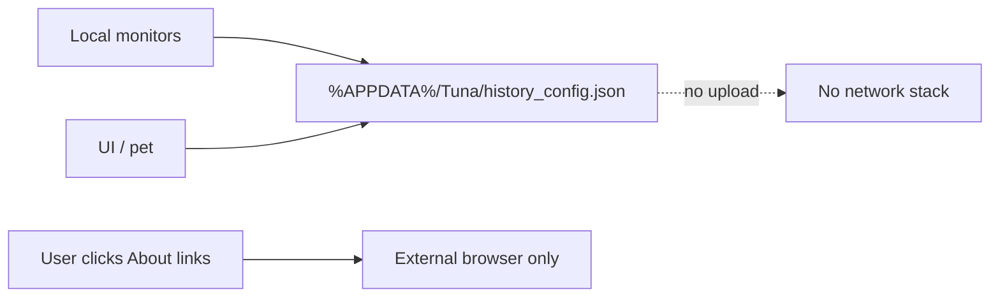

# Translate Tuna to English + Security Assessment

## Security assessment (already completed)

**Verdict: No malicious or covert malware found.** Confidence ~90% on this small, fully readable source tree.

Tuna is a local Avalonia/.NET 8 Windows utility (Explorer history + floating panel + desktop pets). Notable but **intentional / non-malicious** behaviors:

- **Default-on local monitoring** in [`MainViewModel.cs`](ExplorerHistoryTracker/ViewModels/MainViewModel.cs): polls processes (~2s), Explorer folders via Shell COM, and `%APPDATA%\Microsoft\Windows\Recent\*.lnk`. Writes only to `%APPDATA%\Tuna\history_config.json` — **no network exfil**.
- **Undocumented hotkey** `Ctrl+Alt+Shift+Win+F13` in [`MainWindow.axaml.cs`](ExplorerHistoryTracker/MainWindow.axaml.cs) (Quicker integration; not shown in UI).
- **Open/Save dialog path injection** via `SendMessage` in [`FileDialogNavigationService.cs`](ExplorerHistoryTracker/Services/FileDialogNavigationService.cs) — product feature, not process injection.
- **Gzip-embedded Skia/HarfBuzz natives** extracted at startup ([`NativeLoader.cs`](ExplorerHistoryTracker/NativeLoader.cs)) — packaging for single-file publish.
- **Build-only**: UPX download in [`发布.ps1`](ExplorerHistoryTracker/发布.ps1); Huawei NuGet mirror in [`nuget.config`](ExplorerHistoryTracker/nuget.config).

**Not found:** runtime HTTP/sockets, credential/clipboard theft, keyloggers, persistence, reverse shells, miners, remote eval, stego payloads, sneaky Chinese malware commentary.

This assessment will be summarized in the final response after translation (no new markdown file unless you ask for one).

## Translation approach (chosen default)

**Hardcode English** in place of Simplified Chinese. Do **not** add Avalonia localization / `.resx` / language switcher — the project already uses `<InvariantGlobalization>true</InvariantGlobalization>` and has no i18n infrastructure; “translate the repo to English” fits a one-language English product.

**In scope**
- All user-facing UI strings (AXAML + C# alerts/dialogs)
- [`README.md`](README.md)
- Chinese comments in `.cs` / `.csproj` / publish script
- Chinese pet `displayName` / `description` in pet JSON
- Rename Chinese scripts/paths: `编译.bat` → `build.bat`, `发布.ps1` → `publish.ps1`, gitignore `软件发布/` → `publish-output/`

**Out of scope**
- Renaming C# namespaces/types (`ExplorerHistoryTracker` stays)
- Translating git history
- Changing brand/proper nouns (Tuna, Quicker, GitHub URLs, QQ group id, author attribution)

## Files to change (by Chinese hit count)

| Priority | File | Work |
|----------|------|------|
| High | [`MainWindow.axaml`](ExplorerHistoryTracker/MainWindow.axaml) (~125 hits) | Tabs, menus, tooltips, settings, about |
| High | [`MainViewModel.cs`](ExplorerHistoryTracker/ViewModels/MainViewModel.cs) | Alert titles/bodies, folder picker title |
| High | [`README.md`](README.md) | Full English rewrite of product docs |
| Med | [`FileDialogNavigationService.cs`](ExplorerHistoryTracker/Services/FileDialogNavigationService.cs) | Error messages |
| Med | [`RelativeTimeConverter.cs`](ExplorerHistoryTracker/Converters/RelativeTimeConverter.cs) | `刚刚` → `Just now`, `N分钟前` → `N min ago`, etc. |
| Med | [`FloatBallWindow.axaml`](ExplorerHistoryTracker/FloatBallWindow.axaml) | Pet menu: Hide / Settings / Exit |
| Med | [`MainWindow.axaml.cs`](ExplorerHistoryTracker/MainWindow.axaml.cs) | Dialog alerts + hotkey comments |
| Low | [`NativeLoader.cs`](ExplorerHistoryTracker/NativeLoader.cs), [`App.axaml.cs`](ExplorerHistoryTracker/App.axaml.cs), [`ConfigManager.cs`](ExplorerHistoryTracker/Services/ConfigManager.cs), [`ExplorerHistoryTracker.csproj`](ExplorerHistoryTracker/ExplorerHistoryTracker.csproj) | Comments only |
| Low | Pet JSON for `douya-chick`, `ikkun` | English display/description |
| Low | Scripts + [`.gitignore`](.gitignore) | Rename + English comments; update README build instructions |

## Execution steps

1. Replace UI strings in AXAML/C# with natural English; keep binding keys and internal config values (`"Recent"`, theme names) unchanged.
2. Translate relative-time and dialog/error copy.
3. Translate Chinese comments in services/loader/csproj.
4. Translate pet metadata that is still Chinese.
5. Rename `编译.bat` / `发布.ps1`, update their internal path char-code tricks and README/csproj references; update `.gitignore` publish folder name.
6. Rewrite [`README.md`](README.md) in English (features, pets, data path, build, structure).
7. Grep for remaining CJK (`[\u4e00-\u9fff]`) and fix stragglers (except intentional proper nouns if any).
8. Spot-check that the project still builds (`dotnet build ... -c Release`) if the SDK is available.

## Deliverables

- English UI + docs + comments + English script names
- Verbal security report in the completion message (findings above)